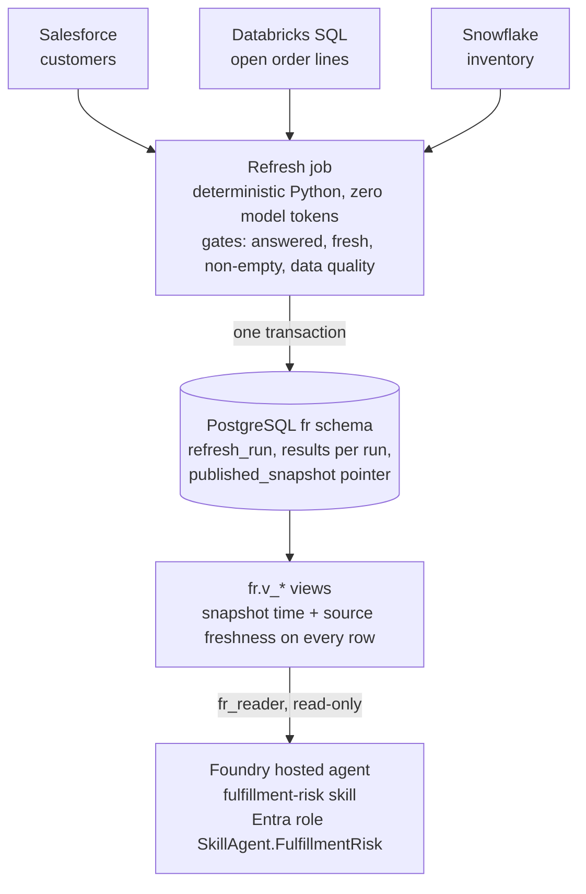

# Architecture

**Who does what:**
- **Systems of record:** Salesforce, Databricks and Snowflake keep owning the data. Version 1 only reads from them.
- **Refresh:** the only writer. It runs on a schedule in Phase 6 and does all joins, allocation and classification in Python.
- **Snapshot:** stores only the fulfillment-risk result and the run history. It is the one trusted dataset, used for conversation now and for dashboards if they're ever wanted.
- **Agent (Phase 7):**
  - The model picks the skill, explains the snapshot and answers follow-ups. It never calculates.
  - Tools read `fr.v_*` through `fr_reader`.
  - Entra roles decide who can see and use the skill.

**Phase 6 (planned):**
- **Refresh:** Azure Container Apps Job on a cron schedule, with a user-assigned managed identity.
- **Database:** Azure Database for PostgreSQL Flexible Server (Burstable B1ms) with Entra authentication, no passwords.
- **Secrets:** Salesforce and Snowflake credentials in Key Vault.
- **Monitoring:** every run traced to Application Insights.
- **Location:** resource group DB, eastus.
